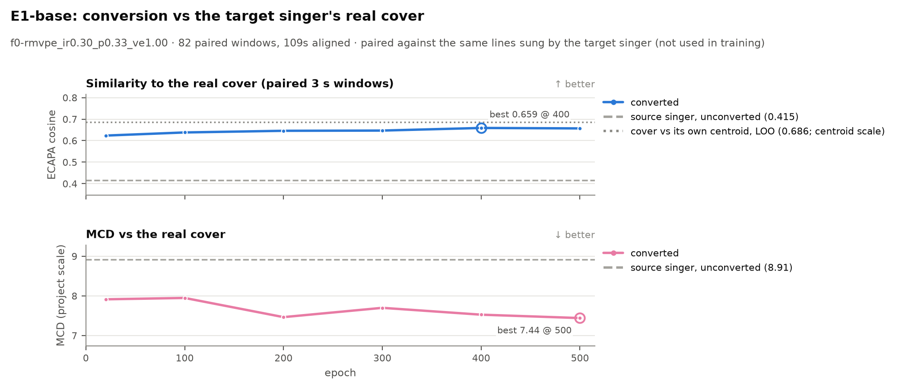
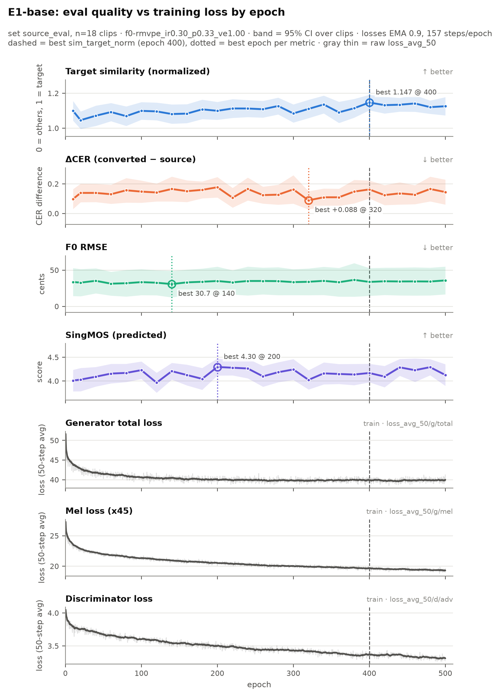
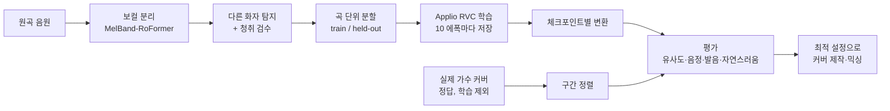

# 그 가수가 정말 부른 것처럼: 실제 가수와의 차이를 측정하고 좁히는 AI 커버 프로젝트

> 목소리만 바꾸는 AI 커버가 아니라, **"실제로 그 가수가 부른 것 같은" 노래**를 목표로 합니다.
> 그 목표에 얼마나 가까운지를 **목표 가수가 실제로 부른 음원과 직접 비교해서** 재고, 남은 차이를 실험으로 좁혀 갑니다.
> 노트북 GPU(RTX 4050, 6GB) 한 대로 RVC 노래 음성 변환 모델을 직접 학습했습니다.
>
> 개인 학습·연구 프로젝트입니다. 실존 가수의 목소리 모델과 변환 음원은 공개하지 않습니다([공개 범위와 권리](#공개-범위와-권리)).

**한눈에 보기**

- **정답이 있는 평가:** 목표 가수가 같은 곡을 직접 부른 커버를 학습에서 빼고 정답으로 썼습니다. 원곡 가수와 실제 가수 사이의 차이를 **약 83% 좁혔습니다.** 정답 커버와의 화자 유사도는 0.405에서 0.637로 올랐고, 실제 커버 내부 기준은 0.686입니다.
- **loss ≠ 품질:** 학습 loss는 500 에폭까지 내려가지만, 목표 가수 유사도는 첫 체크포인트에서 이미 대부분 오르고 400~500 에폭에서 정점입니다.
- **가설은 측정으로 확인:** 청취로 찾은 문제 5건을 음향 측정으로 진단했고, 그중 "관객 함성이 학습돼 고음에 쇳소리가 난다"는 첫 가설은 측정과 맞지 않았습니다.
- **진단 → 재학습으로 검증:** 대신 좁혀낸 원인("라이브 무대의 눌린 발성")을 확인하려고 라이브 TV 무대 음원 6곡(학습 데이터의 40%)을 빼고 다시 학습했습니다. 고음 발성이 6개 체크포인트 모두에서 덜 눌렸고, 목소리 유사도와 발음은 그대로였으며, 학습 시간은 40% 줄었습니다. 청취 판단("고음이 깔끔해짐")도 같은 결론이었습니다.
- **현재 위치:** 1단계(음색) 기준 모델 완성 → 2단계(소리 완성도) 실험 중 → 3단계(창법) 설계 완료

## 왜 이 프로젝트인가

AI 커버를 들으면 "목소리는 비슷한데 그 가수 같지는 않다"는 느낌이 자주 듭니다. 이 프로젝트는 그 간극을 세 단계로 나눠서 하나씩 좁혀 갑니다.

| 단계 | 질문 | 다루는 방법 |
| --- | --- | --- |
| 1. 음색 | 목소리가 그 가수처럼 들리는가? | 데이터 정제, 체크포인트 선택 (E1, E4~E7) |
| 2. 소리의 완성도 | 발음이 뭉개지거나 쇳소리가 나지 않는가? | 추론 설정, 입력 전처리, 원인 진단 (E2, E3, 진단) |
| 3. 창법 | 비브라토·강약·음 시작까지 그 가수다운가? | 표현 전이 모듈 (E9, 설계) |

RVC 같은 음성 변환 모델은 **음색만 바꾸고 음높이 흐름(비브라토·강약·음 시작)은 원곡 가수의 것을 그대로 씁니다.** 이 프로젝트에서도 변환 결과의 비브라토 깊이는 목표 가수(±77 cents)가 아니라 원곡 가수(±65 cents)를 따라갔습니다. 그래서 이 한계를 먼저 측정하고, 그다음 넘어서는 방법을 찾습니다.

## 이 프로젝트의 접근

### 1. 정답이 있는 평가

목표 가수(규현)는 변환 대상 곡(팀 「사랑합니다…」)의 일부를 직접 커버한 적이 있습니다. 이 음원을 **학습에서 완전히 분리해 정답(gold reference)으로** 씁니다. 정답 음원은 로컬에서 평가에만 쓰고, 저장소에는 정렬 결과와 지표만 있습니다.

- 화성(chroma)·음색(MFCC) 특징의 부분 정렬(subsequence DTW)과 음높이 일치 검증으로, 실제 가수가 부른 구간과 원곡 구간을 자동으로 맞춥니다. 8개 구간(1절, 첫 후렴, 마지막 후렴), 약 109초가 맞춰졌습니다.
- 정렬은 두 가지로 검증했습니다.
  - 합성 데이터: 템포를 ±8% 바꾸고, 구간 순서를 바꾸고, 다른 곡 소절을 끼워 넣었습니다. 시간 오차 중앙값은 10 ms였고, 끼운 소절은 거부했습니다.
  - 음성 대조군: **같은 가수가 부른 다른 곡 8곡, 100구간**을 넣었더니 모두 거부했습니다. 매칭 점수는 최대 0.007로, 정답 구간(0.22~0.46)과 겹치지 않았습니다.
- 체크포인트와 설정마다 "변환 결과가 원곡 가수보다 **실제 그 가수의 노래**에 얼마나 가까워졌는가"를 화자 유사도와 음색 거리(MCD)로 잽니다.

### 2. 학습 loss가 아니라 실제 품질로 고르기

RVC의 학습 loss는 GAN의 학습 loss라서 품질을 직접 보여주지 않습니다. 10 에폭마다 체크포인트를 저장하고, 그중 26개(10 에폭, 그리고 20 에폭 간격)를 고정된 평가 세트로 평가해서 loss 곡선과 실제 품질 곡선을 나란히 비교합니다(E1).

### 3. 귀로 듣고, 숫자로 확인하고, 반박해 보기

청취 피드백("1:09에 뭔가 섞였다", "고음에서 쇳소리가 난다")을 받으면 원인 가설을 세우고 음향 특징으로 측정합니다. 그다음 **다른 방법으로 그 결론을 반박해 보는 두 번째 검토**를 거칩니다. 그럴듯한 첫 가설이 측정과 맞지 않은 경우가 실제로 있었습니다(아래 진단 표).

### 4. 데이터는 듣고 고른다

라이브 음원에 섞인 관객 함성, 듀엣 상대, MC 멘트를 찾기 위해 **구간별 화자 임베딩으로 "다른 목소리" 의심 구간을 자동 탐지**하고, 사람이 그 구간만 들어서 판단합니다. 74분 중 약 5분만 들으면 됩니다.

## 지금까지의 결과

> 아래 수치는 개인 감상용(Private) 트랙의 결과입니다. 목소리 모델과 음원은 공개하지 않고, 지표·그래프·코드만 공개합니다.

### 실제 가수의 노래에 얼마나 가까워졌나



| | 정답 커버와의 화자 유사도 ↑ | 음색 거리(MCD, 프로젝트 내부 척도) ↓ |
| --- | --- | --- |
| 원곡 가수 (변환 전) | 0.415 | 8.91 |
| 변환, 20 에폭 | 0.624 | 7.91 |
| 변환, 400 에폭 | **0.659** | 7.53 |
| 변환, 500 에폭 | 0.657 | **7.44** |

- **상한과 비교:** 정답 커버의 구간끼리 비교한 자기 유사도는 0.686입니다. 같은 척도(centroid 기준)로 원곡 가수 0.405 → 변환 0.637(400 에폭)이라, 원곡과 실제 가수 사이 차이의 **약 83%를 좁혔고 17%가 남았습니다.**
- 3초 창 82개(1초 간격으로 서로 겹침) 중 500 에폭 기준 80개에서, 변환 결과가 원곡 가수보다 실제 가수에 가까웠습니다.
- 500 에폭은 20 에폭보다 유사도가 높았고(+0.033), 400과 500은 유사도 차이가 거의 없었습니다(−0.002).
- **청취 판단과 정답 지표가 같은 방향이었습니다.** 감상용 설정(index-rate 0.75)으로 들었을 때 "500 에폭이 300 에폭보다 낫다"고 판단했고, 정답 지표도 500 vs 300에서 유사도 +0.010, MCD 7.70 → 7.44였습니다.

### 학습 loss와 실제 품질 (E1)



- mel loss는 500 에폭까지 계속 내려가지만(전체 생성자 loss는 220 에폭 이후 평탄), 목표 가수 유사도는 **첫 체크포인트(10 에폭)에서 이미 대부분 오르고** 이후 천천히 올라 400 에폭(held-out 기준 500 에폭)에서 가장 높습니다.
- 발음 오류·음정 오차·자연스러움 예측 점수는 에폭에 따른 뚜렷한 경향 없이 오르내렸습니다.
- 62분 데이터에서는 500 에폭까지 held-out 지표가 나빠지지 않아 뚜렷한 과적합이 보이지 않았습니다(데이터 양의 영향은 E5에서 확인).

### 청취 피드백 진단

| 들은 문제 | 처음 가설 | 판정 | 측정해 보니 |
| --- | --- | --- | --- |
| 1:09에 다른 소리가 섞임 | 원곡의 코러스가 함께 변환됨 | 수정 | 원곡 보컬의 **약한 꼬리 소리를 모델이 완전한 음으로 노래함** (주기성 52% → 92%) |
| 긴 음 끝이 어색함 | 음정 추출 오류 | 수정 | 음정은 정상(오차 약 14~16 cents). **원곡의 페이드아웃을 따르지 않는 음량 설정(volume envelope 1.0)**이 유력 → E2에서 확인 |
| 마지막 소절 발음이 어눌함 | 높은 index-rate (0.75) | 보류 | 원곡에서 무성음인 자음 프레임의 **약 40~70%가 변환 후 유성음으로 바뀜** (측정 방법에 따라 다름). index-rate 영향은 E2에서 확인 |
| 고음 쇳소리 | 라이브 음원의 관객 함성이 학습됨 | 기각 → 새 원인 검증 | 라이브 음원에 시끄러운 무성 구간이 많긴 하지만 고음역 에너지가 낮은 어두운 소리였고, 고음 학습 데이터도 충분했음. 남은 후보 중 **무대식 눌린 발성**을 E4 재학습으로 확인(아래) |
| "실제 가수가 더 감미롭게 부름" | — | 새 원인 | 비브라토 깊이가 원곡 가수를 따라감(규현 ±77 / 팀 ±65 / 변환 ±66 cents). 강약 폭은 원곡보다도 좁아짐(규현 18.9 / 팀 16.3 / 변환 14.4 dB). **비브라토는 RVC 구조의 한계**, 강약은 음량 설정의 영향일 수 있어 E2에서 분리 → 남는 차이를 E9에서 다룸 |

### 진단을 재학습으로 검증 (E4)

진단에서 좁힌 원인("라이브 무대의 눌린 발성이 학습됨")이 맞다면, 라이브 TV 무대 음원 6곡을 빼고 학습했을 때 고음 발성이 덜 눌려야 합니다. 학습 데이터는 62.7분에서 36.6분으로 줄었고, 평가 세트와 정답 커버는 그대로 두었습니다.

| 항목 (E4 − E1) | 결과 | 근거의 강도 |
| --- | --- | --- |
| 고음(D4~G4) 발성, H1-H2 ↑ | **+2~7 dB, 6개 체크포인트 모두 개선.** 정답 커버와의 차이를 30~37% 좁힘 | 강함: 음정 추출기 두 종류, 학습량(스텝)을 맞춘 비교에서도 동일 |
| 클라이맥스(2:29~3:23) 고음 밝기 | 정답 커버와 거의 같은 수준으로 내려옴 | 강함 |
| 정답 커버와의 음색 거리(MCD) ↓ | 모든 체크포인트에서 약 0.4 개선 | 방향은 확실. 단, 약 60%는 전체 음색이 어두워진 효과 |
| 목소리 유사도, 발음 | 변화 없음 | 강함 |
| held-out 클립의 세밀한 음색(MCD) | 약간 나빠짐(+0.2) | 데이터가 40% 줄어든 대가 |
| 학습 시간 | 10시간 → 6시간 | — |

청취 A/B 비교에서도 "고음이 깔끔해졌고, 가수다운 느낌은 나빠지지 않았다"는 판단이 나와 지표와 같은 방향이었습니다. 원곡 보컬의 잔향 꼬리(1:10)처럼 데이터로 고칠 수 없는 문제는 예상대로 남았고, 입력 전처리 실험으로 넘깁니다. 통계와 반박 검토는 [runs/E4-no-masked/analysis/](runs/E4-no-masked/analysis/)에 있습니다.

측정 그림과 반박 검토 결과는 [runs/E1-base/diagnosis/](runs/E1-base/diagnosis/)에 있습니다. 예를 들어 고음 쇳소리와 음높이의 관계는 `C_harshness_vs_pitch.png`, 반박 검토 결과는 `skeptic_C_stats.json`에 있습니다.

## 실험 현황

| ID | 질문 | 상태 |
| --- | --- | --- |
| E1 | 학습 loss는 실제 품질을 보여주는가? | 완료 |
| E2 | 유사도·발음·음량 흐름의 trade-off (index-rate × protect × volume envelope) | 예정 |
| E3 | 어려운 음정 구간에 강한 f0 추출기는? | 예정 |
| E4 | 데이터 정제: 라이브 TV 무대 음원 6곡을 빼면 고음이 나아지는가? | 완료: 고음 발성 개선, 유사도·발음 유지 |
| E5~E8 | 데이터 양, 사전학습 모델, 내용 인코더, 보코더 | 예정 |
| E9 | 목표 가수의 창법(비브라토·강약·음 시작)까지 입힐 수 있는가? | 설계 |

실험 설계와 평가 프로토콜은 [implementation_plan.md](implementation_plan.md)에 있습니다.

## 배운 것

- **loss로 체크포인트를 고르면 안 된다.** loss는 계속 내려갔지만, 품질은 첫 체크포인트에서 이미 대부분 올라와 있었다.
- **그럴듯한 첫 가설도 측정 전까지는 가설이다.** "관객 함성이 쇳소리를 만든다"는 가설은 측정과 맞지 않았다.
- **데이터는 양보다 질, 하지만 공짜는 아니다.** 데이터를 40% 줄였더니 고음은 좋아졌지만 세밀한 음색은 조금 손해를 봤다. 다음은 음원을 통째로 빼는 대신 문제 구간만 거르는 절충안이다.
- **음색 유사도가 올라도 "그 가수 같음"은 다 채워지지 않는다.** 남은 차이는 창법(비브라토·강약)에 있었고, 이것은 모델 구조 밖에서 다뤄야 한다.

## 한계

- 정답 평가는 곡 하나(약 109초, 서로 겹치는 3초 창 82개)입니다. 다른 곡에서도 같은 결론이 나오는지는 아직 모릅니다.
- 화자 유사도 모델(ECAPA)은 말소리로 학습됐습니다. 노래에서는 정답 커버 기준 지표와 청취 판단이 같은 방향인지로만 확인했습니다.
- 자연스러움 점수(SingMOS-Pro, UTMOS22)는 한국어 노래에서 보정되지 않아 참고용으로만 씁니다.
- 청취 판단은 한 사람(본인)이 했습니다.

## 파이프라인



| 단계 | 도구 |
| --- | --- |
| 보컬 분리 | audio-separator (UVR MelBand-RoFormer) |
| 학습·추론 | Applio 3.6.6 (RVC v2, HiFi-GAN, ContentVec, RMVPE) |
| 화자 유사도 | SpeechBrain ECAPA-TDNN |
| 음정 | torchcrepe, pyworld |
| 발음 | faster-whisper (large-v3-turbo) CER |
| 자연스러움 예측 | SingMOS-Pro, UTMOS22 |

## 재현

환경은 세 개(Applio, 보컬 분리, 평가)로 나눠서 씁니다. 설치와 자세한 인자는 아래 문서에 있습니다.

| 문서 | 내용 |
| --- | --- |
| [implementation_plan.md](implementation_plan.md) | 목표, 평가 프로토콜, 실험 설계, 마일스톤 |
| [training_config.md](training_config.md) | Baseline 학습 명령과 Applio 사용 시 주의점 |
| [scripts/README.md](scripts/README.md) | 데이터 도구, 실험 실행기, 평가·그래프 스크립트 사용법 |
| [configs/README.md](configs/README.md) | 실험 설정 파일 만드는 법 |

```bat
:: 실험 하나 = 설정 파일 하나 (E1-base)
evaluation\env\python.exe scripts\run_experiment.py configs\baseline.json prepare train
evaluation\env\python.exe scripts\run_experiment.py configs\baseline.json infer --checkpoints 10,20,40,60,80,100,120,140,160,180,200,220,240,260,280,300,320,340,360,380,400,420,440,460,480,500
:: 평가 기준값은 처음 한 번만 계산 (scripts/README.md 참고)
evaluation\env\python.exe scripts\evaluate.py calibrate --track private
evaluation\env\python.exe scripts\evaluate.py run --run E1-base --mos
evaluation\env\python.exe scripts\eval_reference.py all --run E1-base --epochs 20,100,200,300,400,500
evaluation\env\python.exe scripts\report.py epoch-curve --run E1-base --set source_eval
evaluation\env\python.exe scripts\report.py reference-curve --run E1-base
```

## 공개 범위와 권리

- 개인 학습·연구 목적의 프로젝트이며, 해당 가수·소속사와 관계가 없고 승인이나 후원을 받지 않았습니다.
- 목표 가수의 동의를 받지 않았기 때문에 목소리 모델(.pth, .index), 변환 음원, 원곡·커버 음원은 **공개·배포·공유하지 않습니다.** 변환 결과는 개인 감상용으로만 듣고, 실제 가수의 노래로 소개하거나 업로드하지 않습니다.
- 학습·평가 음원은 공개된 무대·커버 영상의 음원에서 보컬만 분리해 로컬에서만 썼습니다. 저장소에는 코드, 실험 설정, 지표, 그래프만 있습니다(`.gitignore`로 제외).
- 공개 데모는 본인 목소리나 공개 라이선스 데이터셋(GTSinger, CC BY-NC-SA 4.0)으로만 만들고, 모든 데모 음원에 "AI 음성 변환"을 표기합니다.
- 권리자의 요청이 있으면 관련 지표와 그림을 바로 내리겠습니다. GitHub Issues로 연락해 주세요.
