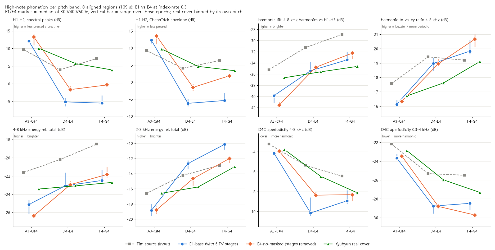

# High-note harshness: E1-base vs E4-no-masked

**Question.** Did removing the six live TV-stage recordings (E4-no-masked: 36.6 min, 5 songs, still including the 킬링보이스 solo live medley) reduce the harsh high notes ("쇳소리") that the listener heard in E1-base (62.7 min, 11 songs)? The listener heard it in 02:29-03:23 and on the verse-1 high notes around 01:19 of the 사랑합니다 cover.

## Verdict

**Partly yes.** Without the TV stages the model sings high notes clearly **less pressed**. In 02:29-03:23 they are also **less bright**, with brightness down to the level of Kyuhyun's real cover. Elsewhere the brightness change is small and mixed. E4 still does not sing like the real cover.

- **Less pressed: yes, large and consistent.** At D4-G4, H1-H2 rises by +1.8 to +6.9 dB from E1 to E4 over the whole song, the aligned regions and 02:29-03:23. The rise holds at every epoch (300, 400 and 500) and every 95% CI excludes 0. On the 8 aligned regions, E4 closes 32-55% of E1's gap to the real cover with the peak-based measure and 43-83% with the envelope-based one.
  - Aligned regions, peak H1-H2, median of the three epochs: at D4-E4 E1 is -5.1 dB, E4 -1.6 dB, the real cover +5.7 dB. At F4-G4 E1 is -5.5, E4 -0.3, the cover +3.9.
  - 02:29-03:23: at D4-E4 E1 is -7.7, E4 -2.7, the cover +7.1. At F4-G4 E1 is -6.2, E4 0.0, the cover +3.3.
  - Tim's own high notes are mostly +1.7 to +7 dB (verse-1 F4-G4: -1.5 dB), so the pressing comes from the model, not from the input. Removing the stages took away roughly a third to a half of it.
- **Less bright: yes in 02:29-03:23 and in 2-8 kHz everywhere; mixed in 4-8 kHz outside that section.**
  - **02:29-03:23, D4-E4.** All three epochs moved, and E4 now matches the real cover on every brightness measure:

    | measure | E1 | E4 | real cover | E4-E1 per epoch |
    |---|---|---|---|---|
    | 4-8 kHz energy | -21.7 | -23.5 | -23.1 | -1.1 to -3.3 |
    | harmonic tilt | -33.8 | -35.7 | -35.5 | -1.7 to -4.4 |
    | 2-8 kHz energy | -10.6 | -14.2 | -14.4 | -2.0 to -3.9 |

    All values are in dB.
  - **02:29-03:23, F4-G4.** 2-8 kHz energy is down at every epoch (-0.8 to -2.8 dB). 4-8 kHz energy and tilt are only clearly lower at 500e.
  - **2-8 kHz energy everywhere.** It is lower in E4 at every epoch and both high bands (-0.5 to -3.9 dB), which moves 40-82% of the way to the cover.
  - **4-8 kHz energy and harmonic tilt outside 02:29-03:23.** E1 was already at the cover's level on the aligned regions: at D4-E4, 4-8 kHz energy is -23.1 dB for E1 and for the cover, and tilt is -35.4 vs -35.6 dB. E4 did not move further. At 300e and 400e it is even about 1 dB brighter at F4-G4, and only 500e is darker.
- **Not fixed.**
  - H1-H2 is still 5-10 dB below the cover at D4-E4.
  - The verse-1 F4-G4 notes are still very pressed: E1 -9.5 dB, E4 -7.1 dB, cover -3.0 dB (peak H1-H2). This rests on only about 2.2 s of frames.
  - 0.3-4 kHz aperiodicity at F4-G4 went further from the cover: E1 -28.5, E4 -29.7, cover -27.3 dB. E4's high notes are even more strictly periodic in the low band.
  - The harmonic-to-valley ratio did not move consistently. It is about 1 dB above the cover at F4-G4.
- **Verse 1 (~01:19).** The improvement is real but small, because E1 was less extreme there to begin with.
  - Peak H1-H2 rises +1.1 to +2.2 dB at 300e and 400e. At 500e the change is not significant.
  - 2-8 kHz energy drops 0.1 to 1.8 dB.
  - 4-8 kHz energy and tilt do not improve: E4 is +0.5 to +1.9 dB brighter at 300e and 400e.
- **Consonant voicing (side check): no change.** Of the source's loud unvoiced frames, both models voice about 62-71% over the whole song (harvest) and 92-100% in 02:29-03:23. Stage removal does not touch this artifact.

**Bottom line.** The data supports the earlier diagnosis that the live-stage belting profile drove the pressed high notes. Removing it moves E4 toward the real cover, mostly in phonation (H1-H2) and in the 2-4 kHz "presence" part of the brightness. The listener's main complaint was 02:29-03:23, and that is where the gain is largest. It does not reach the real cover's soft high-note phonation.

## Figure



All four signals are restricted to the 8 aligned regions (109 s), so the real cover is compared on the same lyrics.

- For E1 and E4, the marker is the median of the three epochs (300, 400, 500) and the bar shows their range.
- Frame measures are binned by Tim's (source) pitch. Peak measures and the real cover are binned by each signal's own pitch.

On the H1-H2 panels (top left), E4 (orange) sits between E1 (blue) and the real cover (green) at D4-E4 and F4-G4. The 2-8 kHz panel shows the same ordering. On the 4-8 kHz and tilt panels, E1 and E4 overlap the cover at D4-E4, and E4 is slightly brighter at F4-G4.

## Method

The measures replicate the E1 diagnosis code in `runs/E1-base/diagnosis`. That code is imported read-only:

- `features.compute` provides harvest F0, D4C aperiodicity, CheapTrick-envelope H1-H2 and the band energies.
- `skeptic_c.measure` provides peak H1-H2, the harmonic-to-valley ratio 4-8 kHz (`hnr48`) and the harmonic tilt (`hrel48`, the 4-8 kHz harmonics against the strongest of H1..H3).
- 2-8 kHz energy relative to the total was added, using the same STFT as the 4-8 kHz measure.

The masks are copied from the earlier scripts:

- **Frame measures:** source voiced, source crepe periodicity above 0.5, and the signal within 35 dB of its maximum (`plot_harsh.py`).
- **Peak measures:** the signal's own F0 at or above 150 Hz, and level above the 30th percentile of its voiced frames (`skeptic_c.py`).

**Replication check.** Re-running these on the cached E1 0.75 covers reproduces `skeptic_C_stats.json` and `C_stats.json` exactly: the maximum absolute difference is 0.000.

**Inputs.**

- E1 and E4 conversions: `runs/<run>/reference/<E>e/f0-rmvpe_ir0.30_p0.33_ve1.00/converted.wav` for 300, 400 and 500e. These are 40 kHz files, resampled to 44.1 kHz. Each was shifted by its envelope-xcorr lag against the source, 3-15 ms.
- Tim's source vocal stem.
- Kyuhyun's real cover vocal stem.

**Bands.** A3-C#4 = MIDI 57-61.5, D4-E4 = 61.5-64.5, F4-G4 = 64.5-68.

**Regions.**

| region | source time | real cover time |
|---|---|---|
| aligned | 8 matched segments of `alignment.json` (same for E1 and E4) | 8 matched segments |
| 02:29-03:23 | 149-203 s | only 03:01.5-03:23 is aligned: ref 106.0-127.5 s |
| verse 1 | segment 4, 76.9-88.5 s (held E4/F#4 at 79.7, 81.1, 82.3, 85.0 s) | 72.3-83.9 s |

**E4-E1 paired differences.** These are taken on identical source frames for each epoch. The 95% CI is a 1-s block bootstrap. An `*` in the tables means the CI excludes 0.

**Sign conventions.**

| measure | meaning of a higher value |
|---|---|
| H1-H2 | less pressed |
| tilt, 4-8 kHz and 2-8 kHz energy | brighter |
| harmonic-to-valley ratio | buzzier, more strictly periodic |
| aperiodicity | noisier, less over-periodic |

## Index-rate 0.3 vs the 0.75 the listener heard

**How it limits the comparison.**

- The main comparison uses the index-rate 0.3 reference conversions. The listener's report came from index-rate 0.75 covers.
- Index rate controls how much of the timbre comes from retrieved training features. At 0.75, more of E1's TV-stage material in its index can leak into the voice. E4's index has none of that material.
- So the 0.3 comparison may understate the stage effect, or miss artifacts that only retrieval brings in, such as stage reverb or crowd noise. The acoustic measures also cannot replace listening.

**What was checked.**

- **Index-rate sensitivity (same model, same frames).** Moving from 0.3 to 0.75 changes every measure here by at most about 0.8 dB at D4-G4. That covers E1 300e, E1 500e and E4 400e:
  - H1-H2: -0.8 to +0.4 dB
  - 2-8 kHz energy: -0.3 to +0.5 dB
  - tilt: -0.3 to +0.5 dB

  These shifts are several times smaller than the E1-to-E4 change in H1-H2 (+1.8 to +6.9 dB). For these phonation and brightness measures, the 0.3 results stand in for 0.75.
- **The comparison at 0.75 itself.** One E4 0.75 cover exists: `dataset/private/covers/사랑합니다__E4-no-masked_400e_t+0.mp3`, made today. Its vocals were recovered with the `recover.py` method (quiet-frame residual -39 dB). Against the E1 0.75 covers (300e and 500e), E4 400e at 0.75 shows the same pattern:

  | measure | region | E4 400e (0.75) minus E1 (0.75) |
  |---|---|---|
  | H1-H2 | whole song | +2.8 to +5.5 dB |
  | H1-H2 | 02:29-03:23 | +3.6 to +7.1 dB |
  | 2-8 kHz energy | whole song | -1.5 to -2.9 dB |
  | 2-8 kHz energy | 02:29-03:23 | -1.3 to -3.7 dB |
  | 4-8 kHz energy, D4-E4 | 02:29-03:23 | -1.2 (vs E1 300e) and -2.7 (vs E1 500e) |

  The numbers are in `index_rate_check` in `harshness.json`.
- **Remaining caveats.**
  - Only one E4 epoch exists at 0.75.
  - The E1 0.75 features are from the earlier diagnosis and were not lag-shifted. Their measured lag is 6-7 ms, under one 10 ms frame.
  - The direct test of the complaint is to listen to the E4 400e 0.75 cover against E1 300e/500e at 02:29-03:23 and 01:17-01:28.

## Tables

All values are in dB, as band medians.

- E1 and E4 columns give the median of the 300, 400 and 500e values, with their range.
- The last column gives the paired E4-E1 median per epoch, in the order 300 / 400 / 500. An `*` means the 95% CI excludes 0.
- The real cover column comes from the aligned regions only.

### 8 aligned regions (109 s; the figure)

| measure | band | Tim | E1 300/400/500 med (range) | E4 300/400/500 med (range) | real cover | E4-E1 paired, per epoch |
|---|---|---|---|---|---|---|
| H1-H2 peaks | D4-E4 | 4.0 | -5.1 (-6.3..-4.0) | -1.6 (-2.3..-0.6) | 5.7 | +3.4* / +4.1* / +1.8* |
| H1-H2 peaks | F4-G4 | 7.1 | -5.5 (-5.5..-3.3) | -0.3 (-0.4..0.4) | 3.9 | +4.0* / +4.2* / +2.6* |
| H1-H2 envelope | D4-E4 | 4.0 | -6.2 (-7.1..-5.0) | -1.6 (-2.5..-0.5) | 4.6 | +4.0* / +4.9* / +2.1* |
| H1-H2 envelope | F4-G4 | 6.3 | -5.4 (-5.8..-3.2) | 1.9 (1.7..2.4) | 3.3 | +4.9* / +5.1* / +3.3* |
| harmonic tilt 4-8k | D4-E4 | -31.3 | -35.4 (-35.6..-33.8) | -34.8 (-35.6..-34.5) | -35.6 | +0.8* / +0.9* / -1.8* |
| harmonic tilt 4-8k | F4-G4 | -28.9 | -33.5 (-33.6..-32.0) | -32.3 (-33.3..-31.8) | -34.6 | +1.0 / +1.8* / -1.0 |
| 4-8 kHz rel. | D4-E4 | -20.2 | -23.1 (-23.1..-21.6) | -22.9 (-23.2..-22.5) | -23.1 | +0.3 / +0.6* / -1.4* |
| 4-8 kHz rel. | F4-G4 | -18.5 | -22.5 (-22.7..-21.3) | -21.8 (-22.1..-21.0) | -22.7 | +0.4 / +1.2* / -0.8 |
| 2-8 kHz rel. | D4-E4 | -14.2 | -12.7 (-13.4..-12.3) | -14.7 (-15.6..-14.6) | -15.8 | -0.5 / -1.4* / -2.7* |
| 2-8 kHz rel. | F4-G4 | -12.9 | -10.2 (-10.8..-10.1) | -12.0 (-12.6..-11.8) | -13.1 | -0.7* / -1.2* / -1.7* |
| harm.-to-valley 4-8k | D4-E4 | 19.4 | 19.0 (18.5..19.4) | 19.0 (18.9..19.3) | 17.6 | -0.6* / +0.5* / -0.2 |
| harm.-to-valley 4-8k | F4-G4 | 19.2 | 19.8 (19.6..20.6) | 20.7 (20.1..21.0) | 19.1 | +0.3 / +1.5* / +0.6* |
| aperiodicity 4-8k | D4-E4 | -5.4 | -10.1 (-10.4..-8.6) | -8.4 (-8.5..-8.0) | -6.5 | +1.3* / +0.3 / +1.1* |
| aperiodicity 4-8k | F4-G4 | -6.5 | -8.9 (-9.2..-7.9) | -8.3 (-9.0..-8.1) | -8.1 | +1.0* / +0.0 / +0.1 |
| aperiodicity 0.3-4k | D4-E4 | -25.3 | -28.8 (-29.6..-28.6) | -28.8 (-28.8..-28.6) | -26.0 | +0.2 / -0.1 / +0.0 |
| aperiodicity 0.3-4k | F4-G4 | -25.5 | -28.5 (-29.2..-28.4) | -29.7 (-29.8..-29.7) | -27.3 | -0.4* / -0.9* / -0.7* |

### 02:29-03:23 (listener range)

Tim, E1 and E4 cover the whole range, 149-203 s. The real cover only covers its aligned tail, 03:01.5-03:23.

| measure | band | Tim | E1 300/400/500 med (range) | E4 300/400/500 med (range) | real cover | E4-E1 paired, per epoch |
|---|---|---|---|---|---|---|
| H1-H2 peaks | D4-E4 | 1.7 | -7.7 (-8.4..-5.6) | -2.7 (-3.2..-2.4) | 7.1 | +5.5* / +5.9* / +3.4* |
| H1-H2 peaks | F4-G4 | 6.6 | -6.2 (-8.0..-4.7) | 0.0 (-0.9..0.5) | 3.3 | +5.3* / +6.3* / +4.0* |
| H1-H2 envelope | D4-E4 | 1.2 | -8.7 (-9.4..-6.7) | -2.3 (-3.0..-2.3) | 6.5 | +6.2* / +6.6* / +4.0* |
| H1-H2 envelope | F4-G4 | 5.6 | -7.1 (-7.9..-4.7) | 2.2 (1.9..3.0) | 2.5 | +6.8* / +6.9* / +4.4* |
| harmonic tilt 4-8k | D4-E4 | -29.8 | -33.8 (-34.2..-31.7) | -35.7 (-35.8..-35.3) | -35.5 | -1.7* / -1.7* / -4.4* |
| harmonic tilt 4-8k | F4-G4 | -28.2 | -32.7 (-33.1..-31.0) | -33.6 (-34.2..-32.9) | -34.5 | -0.7 / +0.3 / -2.9* |
| 4-8 kHz rel. | D4-E4 | -18.9 | -21.7 (-21.8..-20.1) | -23.5 (-23.6..-23.2) | -23.1 | -1.7* / -1.1* / -3.3* |
| 4-8 kHz rel. | F4-G4 | -18.8 | -22.3 (-22.4..-20.8) | -23.2 (-23.4..-22.2) | -22.7 | -1.1 / +0.1 / -2.6* |
| 2-8 kHz rel. | D4-E4 | -12.6 | -10.6 (-11.6..-10.4) | -14.2 (-14.7..-13.9) | -14.4 | -2.0* / -3.0* / -3.9* |
| 2-8 kHz rel. | F4-G4 | -12.7 | -9.9 (-10.8..-9.6) | -12.3 (-12.8..-11.7) | -16.0 | -0.8* / -2.1* / -2.8* |
| harm.-to-valley 4-8k | D4-E4 | 19.3 | 19.4 (18.9..19.5) | 19.0 (18.8..19.5) | 17.9 | -1.1* / +0.2 / -0.7* |
| harm.-to-valley 4-8k | F4-G4 | 19.3 | 19.2 (18.6..19.7) | 19.9 (19.5..20.8) | 20.0 | -0.6 / +1.5* / +0.2 |
| aperiodicity 4-8k | D4-E4 | -6.1 | -11.3 (-11.5..-9.3) | -9.0 (-9.2..-8.4) | -7.3 | +1.6* / +0.5* / +1.4* |
| aperiodicity 4-8k | F4-G4 | -6.2 | -8.5 (-9.6..-7.6) | -8.0 (-8.8..-8.0) | -8.3 | +1.2* / -0.0 / -0.0 |
| aperiodicity 0.3-4k | D4-E4 | -25.8 | -28.9 (-29.5..-28.5) | -29.2 (-29.3..-29.0) | -26.8 | +0.0 / -0.5* / -0.2 |
| aperiodicity 0.3-4k | F4-G4 | -25.3 | -27.6 (-28.4..-27.3) | -29.7 (-29.7..-29.4) | -27.1 | -0.8* / -1.7* / -1.6* |

### Verse 1 high notes (~01:19, aligned segment 4)

The sample is small: about 4.5 s of D4-E4 and 2.2 s of F4-G4 frames.

| measure | band | Tim | E1 300/400/500 med (range) | E4 300/400/500 med (range) | real cover | E4-E1 paired, per epoch |
|---|---|---|---|---|---|---|
| H1-H2 peaks | D4-E4 | 5.9 | -0.2 (-1.0..0.5) | 1.3 (0.9..2.3) | 6.1 | +1.1* / +1.2* / -0.6 |
| H1-H2 peaks | F4-G4 | -1.5 | -9.5 (-9.6..-6.5) | -7.1 (-8.2..-6.3) | -3.0 | +1.3* / +2.2* / +0.9 |
| H1-H2 envelope | D4-E4 | 5.1 | -0.6 (-0.8..-0.2) | 2.1 (1.9..2.2) | 5.8 | +1.6* / +1.4* / +0.1 |
| H1-H2 envelope | F4-G4 | -2.7 | -10.8 (-11.3..-7.6) | -8.8 (-9.1..-7.7) | -5.0 | +2.2* / +2.6* / +0.9* |
| harmonic tilt 4-8k | D4-E4 | -30.6 | -34.0 (-34.8..-32.8) | -33.9 (-33.9..-33.5) | -34.7 | +1.4* / +0.4 / -1.1 |
| harmonic tilt 4-8k | F4-G4 | -27.0 | -34.5 (-34.9..-32.9) | -33.9 (-34.0..-33.1) | -34.9 | +0.9* / +1.8* / -1.0 |
| 4-8 kHz rel. | D4-E4 | -19.4 | -22.2 (-22.9..-21.0) | -21.6 (-21.7..-21.5) | -23.4 | +1.2* / +1.0 / -0.6 |
| 4-8 kHz rel. | F4-G4 | -17.7 | -23.1 (-23.6..-23.0) | -22.6 (-22.7..-21.6) | -24.6 | +0.5 / +1.9* / -0.5 |
| 2-8 kHz rel. | D4-E4 | -13.0 | -12.6 (-13.8..-12.4) | -14.8 (-15.1..-14.6) | -15.3 | -0.1 / -1.1 / -1.8* |
| 2-8 kHz rel. | F4-G4 | -13.5 | -11.0 (-11.0..-10.9) | -12.0 (-12.7..-11.9) | -11.7 | -0.5 / -0.9 / -1.6* |
| harm.-to-valley 4-8k | D4-E4 | 19.6 | 19.7 (19.6..20.2) | 20.3 (20.2..20.3) | 18.7 | -0.8 / -0.3 / -0.7 |
| harm.-to-valley 4-8k | F4-G4 | 19.5 | 20.2 (20.2..20.9) | 20.8 (20.0..21.5) | 18.9 | -0.6 / +0.7 / -0.1 |
| aperiodicity 4-8k | D4-E4 | -6.6 | -10.7 (-10.8..-9.4) | -10.0 (-10.1..-9.2) | -9.2 | +0.4 / +0.4 / +0.6 |
| aperiodicity 4-8k | F4-G4 | -6.9 | -10.0 (-10.3..-9.1) | -9.2 (-10.2..-8.8) | -9.8 | +1.5* / +0.0 / +0.8 |
| aperiodicity 0.3-4k | D4-E4 | -26.3 | -29.2 (-29.2..-29.2) | -29.7 (-29.8..-29.5) | -27.4 | -0.3 / -0.1 / -0.8 |
| aperiodicity 0.3-4k | F4-G4 | -26.9 | -29.5 (-29.5..-28.9) | -31.0 (-31.3..-30.6) | -28.9 | -0.4 / -1.4* / -1.0 |

### Whole song

The real cover column again comes from the aligned regions only.

| measure | band | Tim | E1 300/400/500 med (range) | E4 300/400/500 med (range) | real cover | E4-E1 paired, per epoch |
|---|---|---|---|---|---|---|
| H1-H2 peaks | D4-E4 | 3.1 | -5.7 (-7.0..-4.6) | -2.1 (-3.0..-1.3) | 5.7 | +4.0* / +4.9* / +2.2* |
| H1-H2 peaks | F4-G4 | 7.1 | -5.4 (-5.8..-3.6) | 0.3 (-0.1..1.2) | 3.9 | +4.6* / +5.0* / +3.1* |
| harmonic tilt 4-8k | D4-E4 | -31.0 | -35.0 (-35.2..-33.1) | -35.3 (-35.8..-34.9) | -35.6 | -0.1 / +0.1 / -2.7* |
| harmonic tilt 4-8k | F4-G4 | -28.6 | -33.0 (-33.4..-31.6) | -32.9 (-33.6..-32.1) | -34.6 | +0.4 / +1.3* / -1.8* |
| 4-8 kHz rel. | D4-E4 | -20.2 | -23.0 (-23.1..-21.5) | -23.6 (-23.6..-23.0) | -23.1 | -0.1 / +0.1 / -1.8* |
| 4-8 kHz rel. | F4-G4 | -18.9 | -22.5 (-22.8..-21.3) | -22.5 (-22.7..-21.6) | -22.7 | -0.3 / +0.7 / -1.7* |
| 2-8 kHz rel. | D4-E4 | -13.9 | -12.3 (-13.2..-12.0) | -15.0 (-15.8..-15.0) | -15.8 | -0.9* / -1.8* / -3.1* |
| 2-8 kHz rel. | F4-G4 | -12.9 | -10.2 (-11.0..-10.1) | -12.2 (-12.7..-11.8) | -13.1 | -0.7* / -1.6* / -2.1* |
| aperiodicity 0.3-4k | F4-G4 | -25.1 | -27.9 (-28.6..-27.6) | -29.5 (-29.6..-29.5) | -27.3 | -0.6* / -1.3* / -1.1* |

### Consonant voicing (side check)

These are frames where Tim is unvoiced but loud (`skeptic_misc.py` definition: within 30 dB of maximum, crepe periodicity below 0.3, harvest unvoiced). The table shows the fraction that each conversion makes voiced (harvest).

| region (n frames) | E1 300 / 400 / 500 | E4 300 / 400 / 500 | E1 0.75 300 / 500 | E4 0.75 400 |
|---|---|---|---|---|
| whole song (245) | 0.69 / 0.62 / 0.71 | 0.69 / 0.65 / 0.65 | 0.69 / 0.64 | 0.61 |
| 02:29-03:23 (83) | 0.98 / 0.93 / 1.00 | 0.95 / 0.92 / 0.98 | 0.93 / 0.93 | 0.98 |
| verse 1 (18) | 0.78 / 0.61 / 0.89 | 0.61 / 0.28 / 0.28 | 0.56 / 0.44 | 0.28 |

There is no change over the whole song or in 02:29-03:23. Verse 1 looks lower for E4 at 400 and 500e, but it rests on only 18 frames. This artifact does not come from the stage data.

## Caveats

- **Sample sizes.**
  - The real cover covers only part of 02:29-03:23 (03:01.5-03:23): 880 D4-E4 frames and 479 F4-G4 frames.
  - The verse-1 high band is about 2 s.
  - Frames within a note are correlated, which is why the CIs use 1-s blocks.
- **E4 is not uniformly better.**
  - E4 adds 0.2-2 dB of energy above 6 kHz and has higher 4-12 kHz flatness. This is breathier "air", consistent with less pressed phonation, and not the metallic quality reported. It is in the JSON as `hf_6_16k_db` and `flat_4_12k`.
  - E4's 0.3-4 kHz aperiodicity at F4-G4 is further from the cover than E1's.
- **Epoch effects.** 500e is the epoch where E4's brightness drop is clearest. At 300e and 400e, outside 02:29-03:23, the 4-8 kHz energy and tilt differences are near 0 or slightly brighter. A single-epoch comparison could therefore point either way on 4-8 kHz. H1-H2 does not depend on the epoch.
- **E4 removes about 26 min of other material too.** The E1-to-E4 difference measures the effect of the stage removal as a whole, not of the stage acoustics alone.

## Files

Everything is in `runs/E4-no-masked/analysis/`.

| file | contents |
|---|---|
| `harshness_features.py` | Feature extraction on CPU. Recovers the vocals of the E4 0.75 cover(s) from `dataset/private/covers` and caches features in `_cache/`. The cache holds private audio and features and is git-ignored. |
| `harshness.py` | Band medians, replication check, paired bootstrap, index-rate check, consonant check and the figure. |
| `harshness.json` | All numbers: `medians`, `paired_E4_minus_E1_ir0.3`, `index_rate_check`, `consonant_voicing`, `toward_real_cover`, `headline_paired_E4_minus_E1`, `replication_check`, `verdict`. |
| `harshness_E1_vs_E4.png` | The figure. |

**To reproduce:**

```
evaluation\env\python.exe runs\E4-no-masked\analysis\harshness_features.py
evaluation\env\python.exe runs\E4-no-masked\analysis\harshness.py
```
